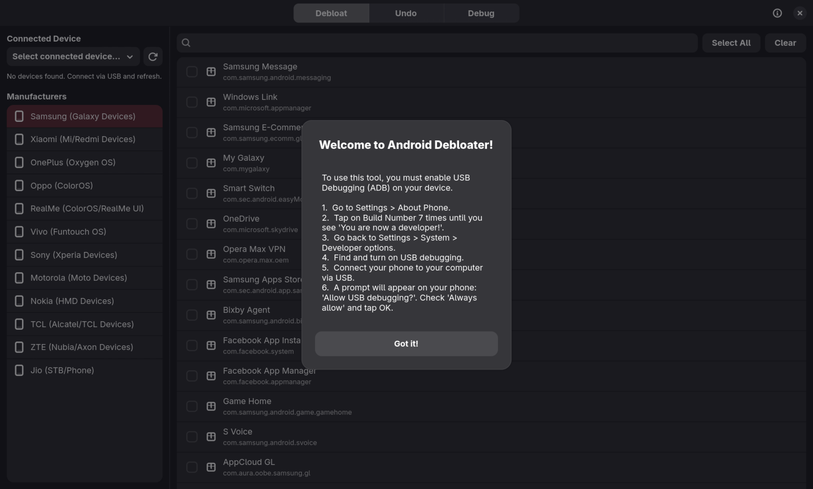
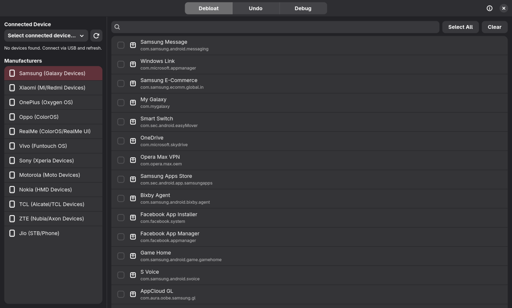

<div align="center">  <h1>Android Debloater</h1> <p><strong>Remove ads, bloatware, and unwanted system apps to free up storage, memory, and speed up your Android device.</strong></p>

<p> <a href="https://github.com/KushagraKarira/Debloat/blob/master/LICENSE">  </a> <a href="https://github.com/KushagraKarira/Debloat/releases">  </a> <a href="https://github.com/KushagraKarira/Debloat/stargazers">  </a> </p> </div>
Android Debloater is a native Linux desktop GUI built in C with **GTK4** and **Libadwaita** that uses **ADB (Android Debug Bridge)** to safely uninstall or disable pre-installed bloatware without requiring root access.

## Features

- **Automatic Device & OEM Detection:** Discovers connected ADB devices and automatically selects the matching manufacturer profile.
- **Installed Package Filtering:** Queries your device for currently installed packages, with live search and an **Installed Only** toggle.
- **Risk-Level Indicators:** Labels packages by risk level (`Safe` vs. `Caution`) so you can review impact before making changes.
- **Batch Debloating:** Uninstalls or disables selected packages asynchronously with real-time progress tracking.
- **Persistent Per-Device Undo:** Saves your debloat history per device so you can restore previously uninstalled or disabled apps from the **Undo** tab.
- **Built-in Debug Tab:** Run custom ADB/debug commands and inspect output directly inside the app.

## Prerequisites

1. **Android Device:** Enable **Developer Options** and **USB Debugging** on your phone, then connect it via USB and authorize the computer.
2. **ADB (`android-tools`):** Ensure `adb` is installed and available in your `PATH`.
3. **Linux Desktop Libraries:** GTK4 (`gtk4`) and Libadwaita (`libadwaita-1`) runtime libraries installed on your system.

## Installation & Usage

1. Download the latest `debloater` binary from the [Releases](https://github.com/KushagraKarira/Debloat/releases) page.
2. Make the binary executable:
   ```bash
   chmod +x debloater
   ```
3. Connect your Android device with USB Debugging enabled and run:
   ```bash
   ./debloater
   ```

> **Note:** Keep `packages.ini` in the same directory as the `debloater` binary (or set the `DEBLOATER_PACKAGES_INI` environment variable to its path) if you are running from a local build.

### Building from Source

If you prefer to compile from source on Linux, ensure `gcc`, `pkg-config`, `gtk4`, and `libadwaita-1` development headers are installed, then clone the repository and build `app.c`:

```bash
git clone https://github.com/KushagraKarira/Debloat.git
cd Debloat
gcc app.c -o debloater $(pkg-config --cflags --libs gtk4 libadwaita-1)
```

## Supported Manufacturers & Categories

| | | | |
| :--- | :--- | :--- | :--- |
| Asus | Carriers | Google | Huawei |
| Jio (incl. Jio STB) | Motorola | Nokia | OnePlus |
| Oppo | RealMe | Samsung | Sony |
| TCL | Vivo | Xiaomi | ZTE |

## Screenshots
<p align="center">   </p>

## Contributing

Contributions are welcome! Check out [CONTRIBUTING.md](https://github.com/KushagraKarira/Debloat/blob/master/CONTRIBUTING.md) and our [Code of Conduct](https://github.com/KushagraKarira/Debloat/blob/master/CODE_OF_CONDUCT.md) to get started:

- Share your device model and package list (`adb shell pm list packages`) in an [Issue](https://github.com/KushagraKarira/Debloat/issues) to help expand device coverage.
- Report bugs, request features, or submit a Pull Request.

## License

This project is licensed under the **GNU General Public License v3.0** — see [LICENSE](https://github.com/KushagraKarira/Debloat/blob/master/LICENSE) for details.

## Contributors

<a href="https://github.com/KushagraKarira/Debloat/graphs/contributors">  </a>
